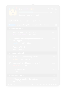
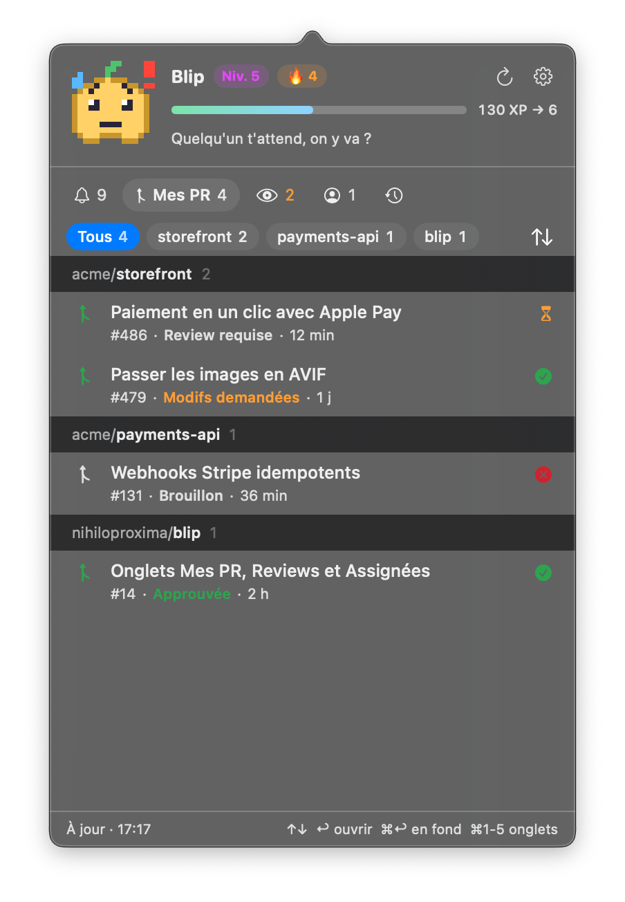
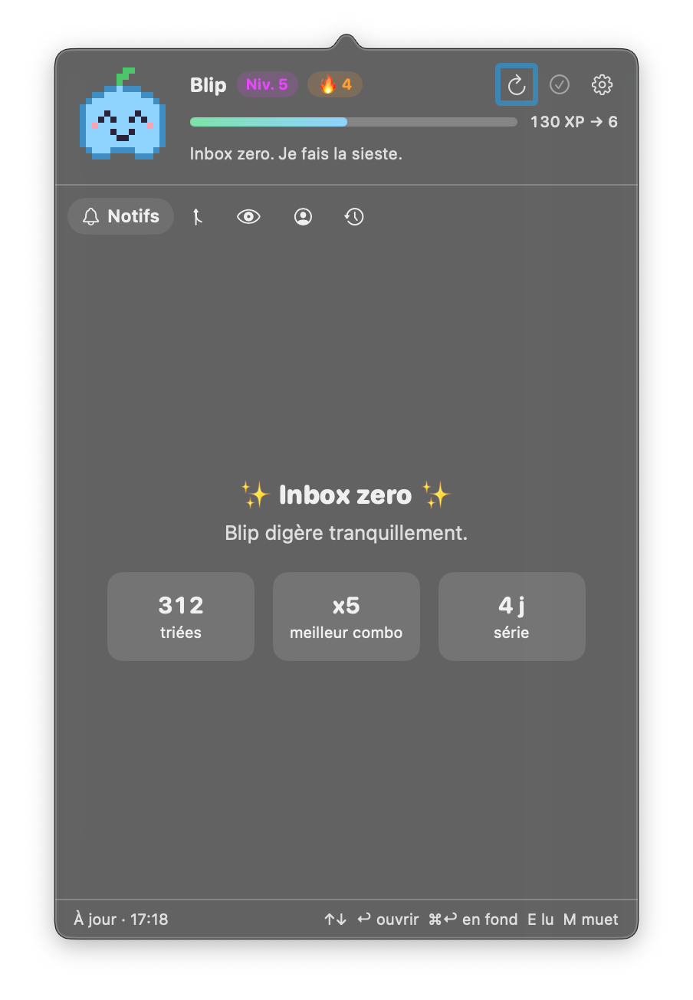
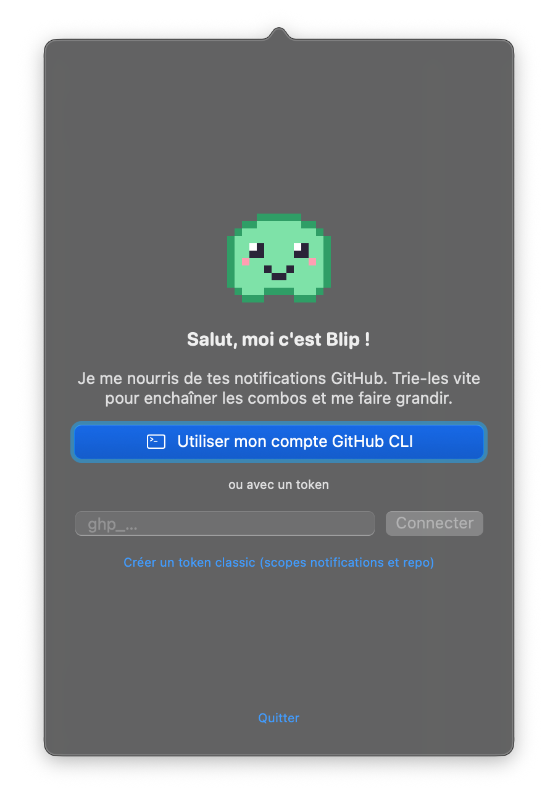

# Blip

Un compagnon en pixel art qui vit dans la barre de menus et se nourrit de tes notifications GitHub.
Une alternative native à [Gitify](https://github.com/gitify-app/gitify) : environ 2 Mo sur disque et 40 Mo de RAM, contre environ 500 Mo pour une app Electron.

<p align="center">
  
</p>

<table>
  <tr>
    <td align="center"></td>
    <td align="center"></td>
    <td align="center"></td>
  </tr>
  <tr>
    <td align="center">Mes PR, CI et reviews</td>
    <td align="center">Inbox zero</td>
    <td align="center">Connexion</td>
  </tr>
</table>

## Fonctionnalités

- **Cinq onglets** (⌘1 à ⌘5) : les notifications non lues, tes PR ouvertes avec l'état de la CI et des reviews, les reviews qu'on attend de toi, ce qui t'est assigné, et l'historique des notifications lues ou archivées.
- **Filtres par dépôt** sous forme de puces, et un menu ⇅ pour grouper par dépôt ou tout trier par date.
- **Tri au clavier** : ouvrir, marquer lu, archiver ou se désabonner sans toucher la souris.
- **Une icône vivante** : quand une notification arrive, le compagnon fait deux petits sauts et passe en couleur jusqu'à ce que tu ouvres le popover.
- **Bannières macOS** : un clic ouvre le fil sur GitHub.
- **Un petit jeu** pour atteindre l'inbox zero : XP, combos, niveaux, accessoires et série quotidienne.
- **Mises à jour intégrées** : Blip te prévient quand une nouvelle version sort et s'installe tout seul.

## Installation

Il faut macOS 14 ou plus récent. La version publiée s'installe en une commande :

```sh
curl -fsSL https://github.com/nihiloproxima/blip/releases/latest/download/Blip.zip -o /tmp/Blip.zip \
  && ditto -x -k /tmp/Blip.zip /Applications && open /Applications/Blip.app
```

Pour compiler depuis les sources (Xcode 16 ou plus récent) :

```sh
git clone https://github.com/nihiloproxima/blip.git && cd blip
./scripts/build.sh --install
```

Au premier lancement, clique sur le blob dans la barre de menus et connecte-toi avec **GitHub CLI** (`gh auth login`) ou avec un **token classic** (scopes `notifications` et `repo`).

Le [guide d'installation](INSTALL.md) détaille les prérequis, la connexion, les réglages, la désinstallation et le dépannage.

## Le jeu

L'humeur du compagnon dépend du nombre de notifications non lues. Elle se voit aussi dans la barre de menus :

| Non lues | Humeur |
| --- | --- |
| 0 | zen, il fait la sieste |
| 1 à 4 | content |
| 5 à 14 | inquiet, il transpire |
| 15 et plus | panique |

Un **!** apparaît à côté de lui quand une review, une mention, une assignation ou une alerte de sécurité t'attend.

- **XP** : chaque notification triée rapporte de l'XP selon sa raison : review ou alerte de sécurité 30, mention ou assignation 20, auteur ou commentaire 10, le reste 5. Le gain s'affiche à droite de chaque ligne.
- **Combos** : si tu tries la suivante en moins de 8 s, le multiplicateur monte jusqu'à x5. « Tout marquer comme lu » rapporte l'XP de base, sans combo.
- **Niveaux** : il faut 50, puis 150, 300, 500… XP cumulés. Le compagnon gagne une pousse au niveau 5, une casquette au niveau 10 et une couronne au niveau 20.
- **Série** : chaque jour où tu atteins inbox zero prolonge la série, avec un bonus d'XP. Les week-ends ne la cassent pas.

## Raccourcis (popover ouvert)

| Touche | Action |
| --- | --- |
| ⌘1 à ⌘5 | changer d'onglet |
| ↑ ↓ | sélectionner |
| ↩ | ouvrir dans le navigateur (et marquer lu) |
| ⌘↩ ou ⌘ clic | ouvrir en arrière-plan, le popover reste ouvert |
| E ou ⌫ | marquer lu |
| M | se désabonner du fil |
| Échap | fermer |

Clic droit sur l'icône : Rafraîchir et Quitter.

## Mises à jour

Blip consulte la dernière release du dépôt au lancement puis toutes les 6 heures. Quand une version plus récente existe, un bandeau la propose en bas du popover. « Installer et relancer » télécharge `Blip.zip`, vérifie le bundle et sa signature, remplace l'app sur place puis la relance. Tu peux aussi lancer la vérification depuis les réglages.

Si l'app n'est pas dans un dossier modifiable, par exemple lancée depuis une image disque, le bandeau renvoie simplement vers la page de la release.

### Publier une version

GitHub Actions ([`release.yml`](.github/workflows/release.yml)) compile chaque push sur `main` et chaque PR, et publie une release à chaque tag `vX.Y.Z` :

```sh
/usr/libexec/PlistBuddy -c "Set :CFBundleShortVersionString 0.2.0" Resources/Info.plist
git commit -am "Version 0.2.0"
git tag v0.2.0 && git push && git push --tags
```

Le workflow vérifie que le tag correspond à la version de `Resources/Info.plist`, compile une app universelle (Apple Silicon et Intel), puis publie `Blip.zip` avec des notes générées à partir des commits.

## Sous le capot

- Swift et SwiftUI, sans aucune dépendance. L'icône de la barre de menus est une `NSStatusItem` avec une image *template* générée depuis le sprite (`Sources/Blip/Pet.swift`).
- Les notifications sont relevées toutes les 60 s, ou selon `X-Poll-Interval`, avec `If-Modified-Since` : tant que rien ne bouge, GitHub répond `304` sans décompter le rate limit. Une liste complète est rechargée toutes les 5 minutes, à l'ouverture du popover et au réveil du Mac.
- Le tableau de bord (Mes PR, Reviews, Assignées) tient en une seule requête GraphQL, rafraîchie toutes les 5 minutes. L'historique est chargé à l'ouverture de son onglet.
- L'état des PR et des issues (ouverte, mergée, fermée, brouillon) est récupéré en une requête GraphQL par lot de 50, et uniquement pour les fils qui ont changé.
- La vue SwiftUI n'existe que pendant que le popover est ouvert : une fois fermé, il ne reste que la boucle de polling.
- L'icône de l'app est générée depuis le sprite au moment du build (`scripts/make-icon`).

En dev, `swift run` lance Blip hors bundle : tout marche sauf les bannières macOS et les mises à jour, qui exigent un `.app`. `swift run Blip -demo 9` affiche des notifications factices, sans réseau : c'est ce mode qui sert aux captures d'écran.
